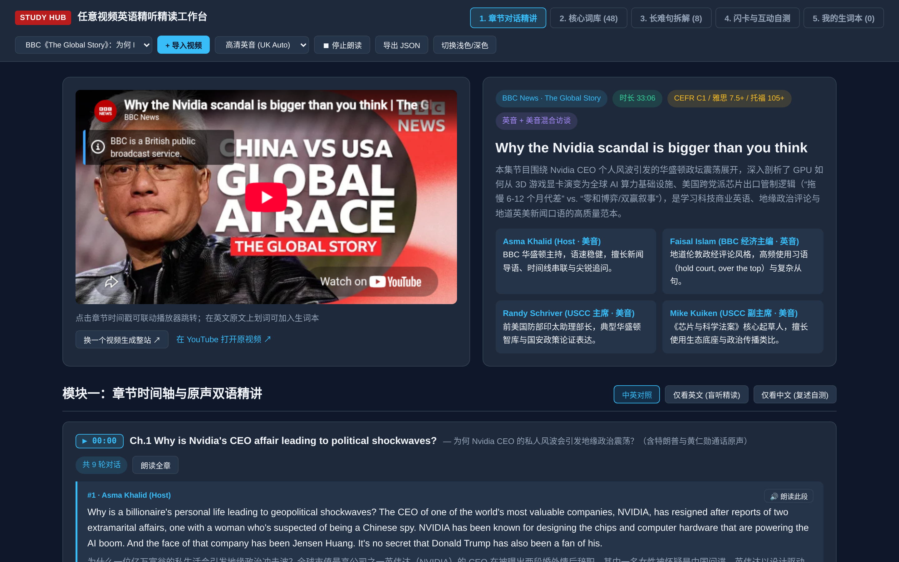
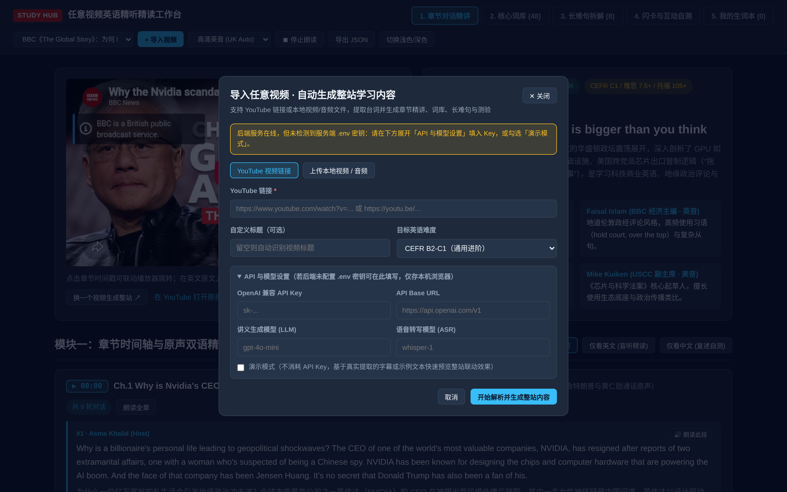

# Video English Study Hub · 任意视频英语精听精读工作台

将任意 **YouTube 英文视频链接** 或 **本地视频/音频文件** 一键转化为全套双语精听精读工作台：
1. **双模式播放器联动**：支持 YouTube 内嵌播放与本地上传 `<video>` 播放，点击任意章节/长难句时间戳自动跳转。
2. **模块一 · 章节时间轴与原声双语精讲**：支持中英对照 / 盲听英文 / 中文复述三种视图与段落跟读。
3. **模块二 · 动态主题核心词库**：根据视频主题自动分类筛选，支持真人词典 / 神经网络语音朗读。
4. **模块三 · 原声长难句拆解**：句型标签、意群切片拆解与仿写示范。
5. **模块四 · 互动练习**：记忆闪卡（内置词库 / 我的生词本切换）、原声完形填空、理解测验与写作框架。
6. **模块五 · 划词生词本**：在英文原文划选 1–8 个词一键收藏，按剧集 ID 隔离存储在 `localStorage` 中，支持导出 CSV。

## 界面预览

### 主工作台与双语章节精讲


### 一键导入任意视频（YouTube 链接 / 本地上传）


## 快速启动

### 1. 安装依赖（需 Python 3.10+ 与 `ffmpeg`）

```bash
python3 -m venv .venv
source .venv/bin/activate
pip install -r requirements.txt
```

### 2. 配置 API 密钥（二选一）

- **方式 A（推荐）：服务端 `.env` 配置**

```bash
cp .env.example .env
# 编辑 .env 填入 OPENAI_API_KEY（支持任意 OpenAI 兼容接口）
```

- **方式 B：网页端填写**
  直接启动服务后，点击页面右上角 **「+ 导入视频」**，展开 **「API 与模型设置」** 填入你的 Key（仅保存在本地浏览器 `localStorage`），或勾选 **「演示模式」** 快速体验联动流程。

### 3. 启动服务

```bash
uvicorn server.app:app --host 0.0.0.0 --port 8000
```

浏览器打开 `http://localhost:8000` 即可使用。

## 目录结构

- `index.html` / `assets/css/style.css` / `assets/js/app.js`：多剧集前端渲染引擎与视频导入弹窗
- `episodes/index.json` & `episodes/*.json`：剧集索引与结构化学习内容（含预置示例 `nvidia-scandal.json`）
- `server/app.py`：FastAPI 接口与静态资源托管
- `server/pipeline.py`：YouTube 字幕抓取、`ffmpeg` 音轨抽取分片、Whisper ASR 转写与 LLM 结构化生成流水线
- `server/schemas.py`：剧集 JSON Pydantic 校验模型
- `tests/test_pipeline.py`：自动化测试套件
- `docs/`：工作台与视频导入弹窗预览截图
